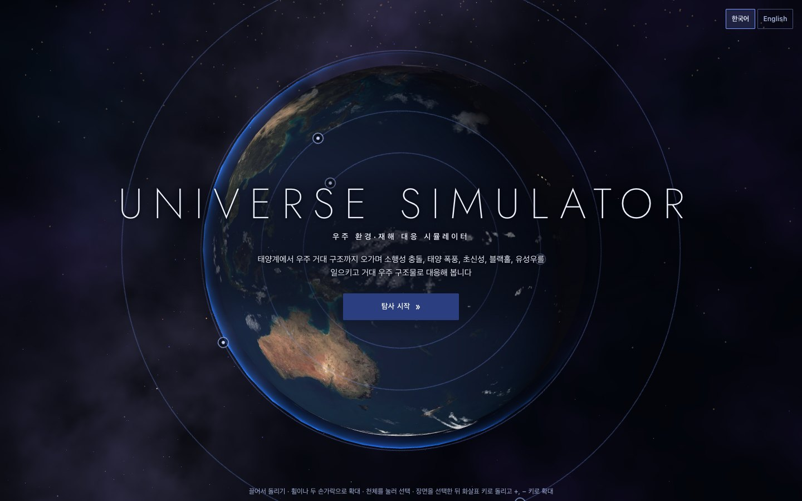
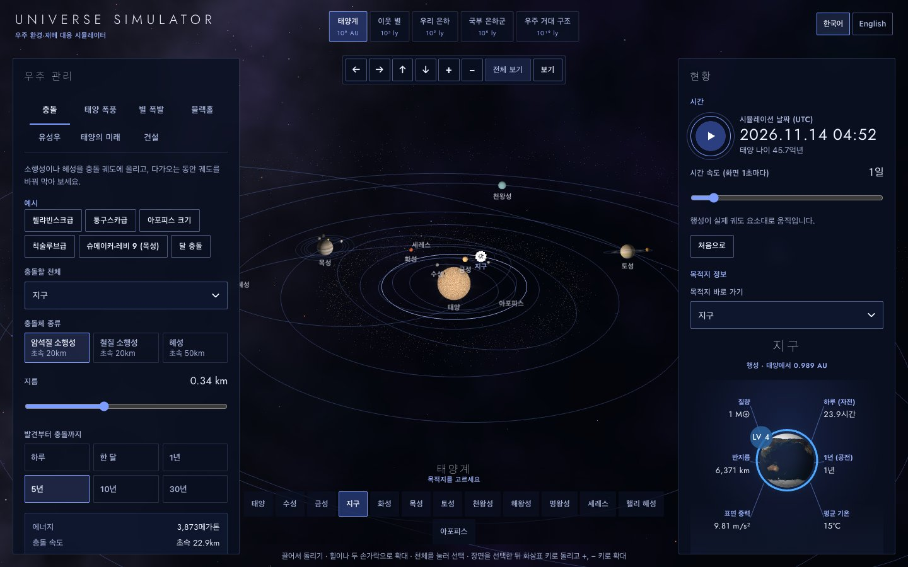
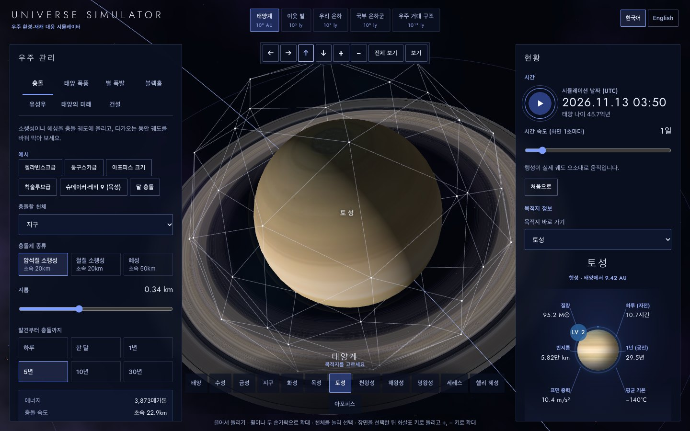
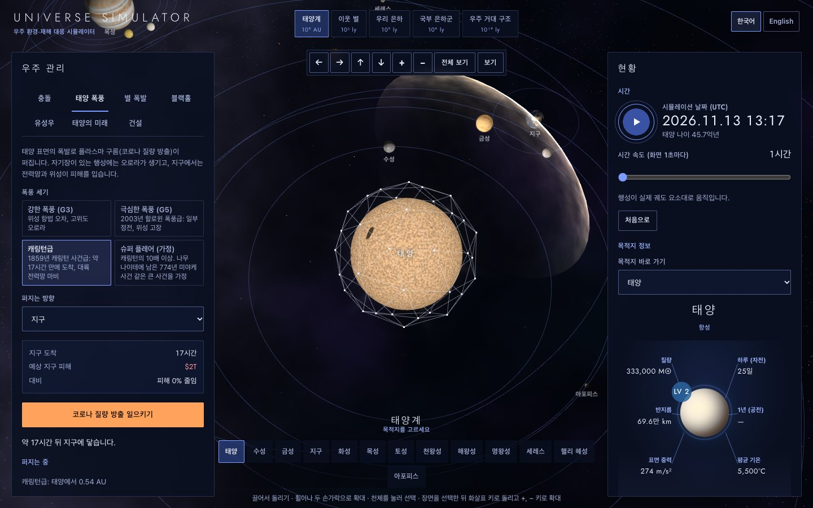
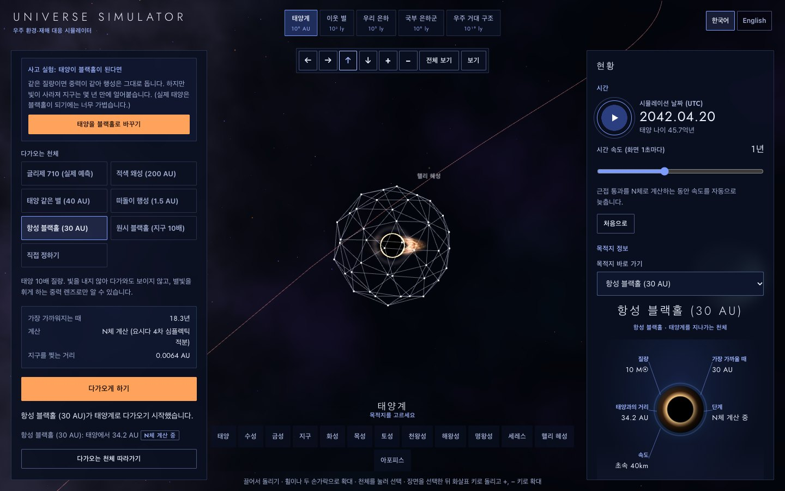
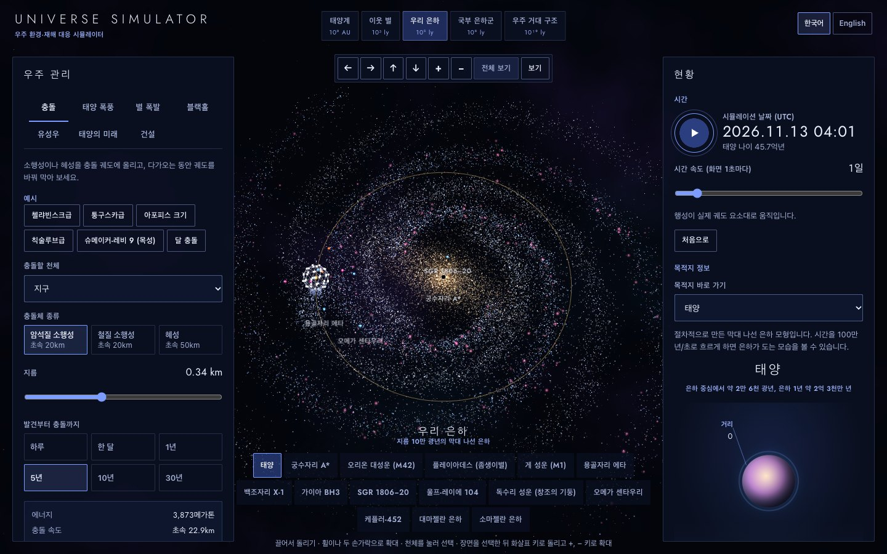
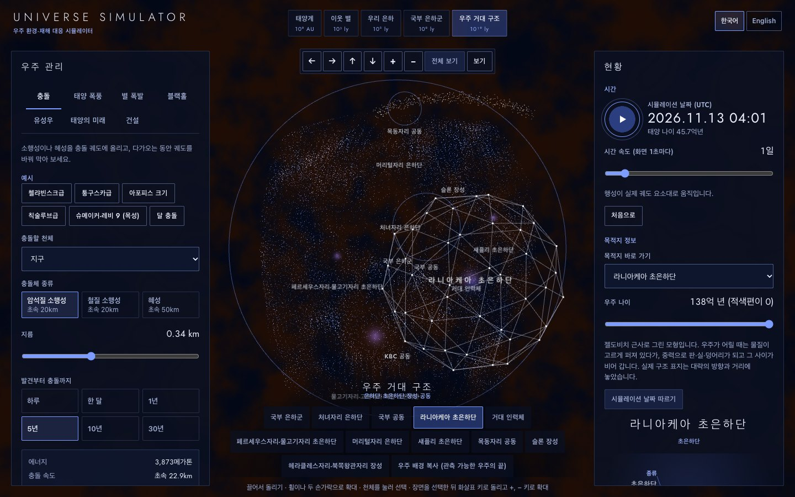
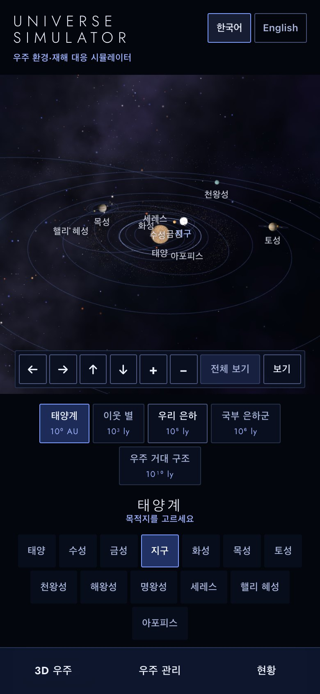

# UNIVERSE SIMULATOR - 우주 환경·재해 대응 시뮬레이터

[](https://github.com/ryushin01/Universe_Simulator/actions/workflows/ci.yml)


태양계에서 우주 거대 구조까지 오가며 소행성 충돌, 태양 폭풍, 초신성·감마선 폭발, 블랙홀 근접 통과, 유성우, 태양의 노화를 일으키고 다이슨 스웜·링월드·궤도 이동 같은 우주 구조물로 대응해 보는 3D 우주 시뮬레이터입니다. [EARTH_PLAN](https://github.com/ryushin01/EARTH_PLAN)의 우주판입니다.

**[데모 바로 보기](https://ryushin01.github.io/Universe_Simulator/)** · [Storybook](https://ryushin01.github.io/Universe_Simulator/storybook/)

> **프로젝트 상태:** 0.1.1까지 만든 **개인 프로젝트**입니다. 행성 위치는 NASA JPL 궤도 요소로 계산하지만, 태양 진화·기후·피해 규모·우주 구조물은 단순화한 모델이라 교육·탐색용으로만 쓰세요. 디자인은 [Space Advisor](https://www.cssdesignawards.com/sites/space-advisor/28977/)(Akufen)를 참고했습니다.

## 화면

| 소개 화면                                                                                           | 태양계와 목적지 정보                                                                                      |
| --------------------------------------------------------------------------------------------------- | --------------------------------------------------------------------------------------------------------- |
|  |  |

| 토성과 측지선 선택 표시                                                      | 캐링턴급 태양 폭풍                                                                                             |
| ---------------------------------------------------------------------------- | -------------------------------------------------------------------------------------------------------------- |
|  |  |

| 블랙홀 근접 통과                                                                                                                | 우리 은하                                                                           |
| ------------------------------------------------------------------------------------------------------------------------------- | ----------------------------------------------------------------------------------- |
|  |  |

| 우주 거대 구조                                                                          | 모바일                                                                                                                                      |
| --------------------------------------------------------------------------------------- | ------------------------------------------------------------------------------------------------------------------------------------------- |
|  |  |

## 주요 기능

| 구분             | 내용                                                                                                                                                       |
| ---------------- | ---------------------------------------------------------------------------------------------------------------------------------------------------------- |
| 5단계 규모       | 태양계 → 이웃 별(1,000광년) → 우리 은하 → 국부 은하군 → 우주 거대 구조. 규모마다 3D 장면과 목적지 목록, 정보 카드                                          |
| 태양계           | JPL 궤도 요소로 계산한 행성·위성·왜소 행성·혜성, IAU 자전축, 소행성대·카이퍼 벨트, 거주 가능 영역, 압축·실제 거리 보기, 고른 천체를 감싸는 측지선          |
| 시간             | 1시간/초부터 10억 년/초까지, 태양 나이에 따른 광도·반지름·질량 변화(적색 거성이 수성·금성·지구를 삼킴, 행성상 성운, 백색 왜성)                             |
| 충돌·편향        | 지름 10m~100km 소행성·혜성의 에너지·크레이터·피해 단계, 운동 충돌체·중력 견인선·핵폭발 편향과 남은 시간에 따른 빗나감 거리                                 |
| 태양 폭풍        | 강한 폭풍~슈퍼 플레어 코로나 질량 방출의 원뿔 확산, 도착 시간, 오로라, 전력망 피해와 경보 위성·전력망 보호                                                 |
| 별 폭발          | 베텔게우스·안타레스·스피카·페가수스자리 IK 초신성, 감마선 폭발, 킬로노바, 마그네타 거대 플레어와 오존층 감소·잔해 도착                                     |
| 블랙홀·떠돌이 별 | 글리제 710·적색 왜성·태양형 별·떠돌이 행성·항성/원시 블랙홀의 근접 통과를 N체(요시다 4차) 계산, 궤도 변화·방출·조석 파괴, 태양을 블랙홀로 바꾸는 사고 실험 |
| 유성우           | 실제 9개 유성우의 극대 날짜와 모혜성 먼지 띠, 지구 대기에 그어지는 유성, 유성 폭풍                                                                         |
| 우주 구조물 16종 | 행성 방위 요격망, 우주 기상 경보 위성, 화성 자기장 방패·테라포밍, 오닐 실린더, L1 차양, 지구 궤도 이동, 다이슨 스웜·다이슨 구, 링월드, 항성 엔진 등        |
| 문명             | 지구·우주 인구, 쓰는 에너지와 카르다쇼프 척도, 에너지에 따라 늘어나는 예산                                                                                 |
| 은하·우주        | 절차적 막대 나선 은하와 은하 1년, 안드로메다와의 충돌(제한된 N체), 우주 나이에 따라 자라는 우주 거미줄, 실제 거대 구조 17곳                                |
| 미션             | 충돌 회피 작전(2026 PDC), 태양 극대기 버티기, 붉은 행성의 봄, 지구를 옮겨라 — 결과 대화상자                                                                |
| 저장·공유·언어   | 주소 공유 링크와 브라우저 저장, 한국어·영어 전환, 홈 화면 설치와 오프라인 캐시                                                                             |

## 기술 스택


| 구분       | 사용 기술                                                                                                                         |
| ---------- | --------------------------------------------------------------------------------------------------------------------------------- |
| UI         | SolidJS 1.9 (Signals), 빌드 때 첫 화면을 HTML로 그리는 SSR 사전 렌더링, TypeScript 6                                              |
| 3D         | three.js 0.187 (직접 제어), 직접 작성한 GLSL 셰이더                                                                               |
| 시뮬레이션 | 케플러 궤도·N체 적분(요시다 4차 심플렉틱)·ΛCDM 성장 인자·젤도비치 근사를 직접 구현                                                |
| 스타일     | CSS Modules + Lightning CSS(중첩, 컨테이너 쿼리), Jost                                                                            |
| 품질       | ESLint(typescript-eslint, eslint-plugin-solid), Prettier, Steiger(FSD), Vitest + Testing Library, Playwright + axe, Lighthouse CI |
| 문서       | Storybook 10 (`storybook-solidjs-vite`, a11y 애드온)                                                                              |
| 배포·CI    | GitHub Pages, GitHub Actions, Service Worker(PWA)                                                                                 |

## 시작하기

Node.js 26(`.nvmrc`)과 pnpm 12가 필요합니다.

```bash
nvm use
pnpm install
pnpm dev    # http://localhost:3100
```

| 명령                                   | 설명                                                                          |
| -------------------------------------- | ----------------------------------------------------------------------------- |
| `pnpm build` / `pnpm preview`          | 정적 사이트 빌드와 첫 화면 사전 렌더링(`dist/client`) / 빌드 결과 실행        |
| `pnpm build:all`                       | 사이트와 Storybook을 함께 빌드 (하위 경로는 `BASE_PATH=/Universe_Simulator/`) |
| `pnpm lint` / `lint:fsd` / `typecheck` | ESLint / FSD 구조 검사 / 타입 검사                                            |
| `pnpm test`                            | 천체 역학·재해·엔진 단위 테스트와 컴포넌트 테스트                             |
| `pnpm test:e2e`                        | 프로덕션 빌드 E2E·접근성 검사 (먼저 `build` 필요)                             |
| `pnpm lighthouse`                      | Lighthouse CI 점수 검사 (먼저 `build` 필요)                                   |
| `pnpm storybook`                       | Storybook 개발 서버 (`http://localhost:6106`)                                 |

## 프로젝트 구조

```
e2e/                     E2E 테스트 (화면 폭, axe, 키보드, 재해·건설·미션·공유 흐름)
public/textures/         행성 텍스처(WebP)
scripts/                 첫 화면 사전 렌더링, PWA 아이콘 생성
src/
├─ app/                  진입점(hydrate·SSR), 전역 스타일과 디자인 토큰
├─ pages/universe/       시뮬레이터 페이지 (FSD pages-first)
│  ├─ model/             천체 역학·태양 진화·기후, 재해·N체, 구조물, 엔진·스토어, 별·은하·우주 자료
│  ├─ lib/               GLSL 셰이더, 은하·우주 거미줄 생성기
│  └─ ui/                소개, 3D 장면(규모별), 패널, 현황·정보 카드
└─ shared/               공통 UI(버튼, 탭, 슬라이더 등), 수학·시간·서식, 다국어
```

## 문서

| 문서                                | 내용                                          |
| ----------------------------------- | --------------------------------------------- |
| [개발 가이드](docs/development.md)  | 구조, 시뮬레이션 모델, 렌더링, 테스트, 접근성 |
| [데이터 출처](docs/data-sources.md) | 궤도 요소·텍스처·천체 자료와 라이선스         |
| [성능](docs/performance.md)         | Lighthouse 측정 결과와 묶음 크기              |
| [배포](docs/deployment.md)          | GitHub Pages 배포와 하위 경로 설정            |
| [버전 기록](CHANGELOG.md)           | 버전별 변경 내용                              |

## 출처

| 자료                                                           | 저작자                           | 사용 허락                                                 | 원본                                                                                                  |
| -------------------------------------------------------------- | -------------------------------- | --------------------------------------------------------- | ----------------------------------------------------------------------------------------------------- |
| 행성 텍스처 (수성·금성·달·화성·목성·토성과 고리·천왕성·해왕성) | Solar System Scope               | [CC BY 4.0](https://creativecommons.org/licenses/by/4.0/) | [Solar System Scope Textures](https://www.solarsystemscope.com/textures/)                             |
| 지구 텍스처 (색·밤 불빛·구름)                                  | three.js authors                 | MIT                                                       | [three.js 예제 텍스처 (r160)](https://github.com/mrdoob/three.js/tree/r160/examples/textures/planets) |
| 행성 근사 궤도 요소                                            | E. M. Standish, NASA JPL         | 공개 과학 자료                                            | [Approximate Positions of the Planets](https://ssd.jpl.nasa.gov/planets/approx_pos.html)              |
| 소천체 궤도 요소 (세레스·아포피스·핼리 혜성·유성우 모천체)     | NASA JPL Solar System Dynamics   | 공개 과학 자료                                            | [Small-Body Database API](https://ssd-api.jpl.nasa.gov/doc/sbdb.html)                                 |
| Jost 글꼴 (영문 제목)                                          | Owen Earl (indestructible type*) | SIL OFL 1.1                                               | [Jost](https://github.com/indestructible-type/Jost) · [Fontsource](https://fontsource.org/fonts/jost) |
| three.js (3D)                                                  | three.js authors                 | MIT                                                       | [three.js](https://github.com/mrdoob/three.js)                                                        |
| SolidJS (화면)                                                 | Ryan Carniato                    | MIT                                                       | [solid](https://github.com/solidjs/solid)                                                             |

자전축·천체 목록·모델 근거 같은 자세한 자료 출처는 [데이터 출처](docs/data-sources.md)에 있습니다. 아이콘, 셰이더로 그린 태양·블랙홀·은하·우주 거미줄, 화면 사진은 이 프로젝트에서 직접 만들었습니다.
